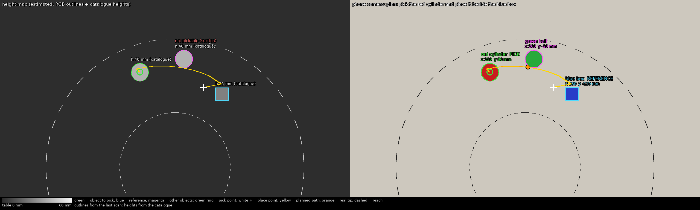
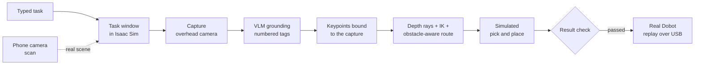

# Dobot Magician VLM pick-and-place

Type a task such as *"pick the red cylinder, place it beside the purple cone and avoid the green sphere"*. A
vision-language model reads it against an overhead camera image, and the Dobot Magician carries it out. The task
runs first in NVIDIA Isaac Sim, then optionally on the real arm, with an ordinary phone as the camera.



## How it works



1. **Capture**: the overhead camera image is rendered and every object in it is found from the scene.
2. **VLM grounding (set-of-marks)**: each candidate object gets a numbered tag. The model only answers which tag
   to pick, which tag is the reference, the relation ("beside", "left of", "behind", ...) and which tags to
   avoid. It never estimates coordinates. A wording parser checks the answer against the typed task.
3. **Geometry**: the chosen pixels are cast as rays into the scene to get real 3D points, the support surface
   and the object heights. A planner searches a collision-free route for the held object.
4. **Execution**: the simulated arm approaches, touches down, latches, lifts, carries, places, releases and
   returns home. The scene is then reset.
5. **Real robot (optional)**: the phone photo is compared with an empty-table photo to find the real objects
   and their positions in robot millimetres. Matching stand-ins are placed in the simulation, the task is planned
   and checked there, and only a checked path is sent to the Dobot.

More detail: [docs/ARCHITECTURE.md](docs/ARCHITECTURE.md).

## Status

| Part | State |
|---|---|
| Simulation pipeline (capture → VLM → plan → pick and place → result check → reset) | Works in Isaac Sim 6.0.1 |
| VLM providers: OpenAI-compatible APIs, Claude API, Claude Code CLI, no-model fallback | Implemented |
| Phone-camera calibration, object detection, RGB "height map" view | Works with an Android phone (IP Webcam) |
| Real Dobot driver, bridge, teleop, auto-park | Teleop and homing tested on the arm |
| Real-robot replay of a simulated plan | In testing; first runs slow, with a hand on the power switch |

## Requirements

- Ubuntu 22.04 or 24.04 with an NVIDIA RTX GPU (8 GB VRAM is enough), NVIDIA Isaac Sim 6.0.x
- The scene assets (USD stage, URDF, Lula YAML). See [assets/README.md](assets/README.md).
- A vision-language model: any OpenAI-compatible API with image input, the Claude API, or a signed-in
  Claude Code CLI
- Real robot only: Dobot Magician with suction cup, USB cable, and an Android phone with the IP Webcam app

## Quick start (simulation)

```bash
git clone https://github.com/<you>/dobot-vlm-pick-place.git
cd dobot-vlm-pick-place
cp .env.example .env            # then set VLM_PROVIDER, VLM_API_BASE, VLM_MODEL, VLM_API_KEY
# put the scene assets in assets/ (see assets/README.md)
bash scripts/start_dobot.sh --check   # checks files, VLM access, GPU
bash scripts/start_dobot.sh           # opens Isaac Sim with the "Dobot pick-and-place" window
```

Type a task in the window and press **Run task**. Full setup: [docs/SETUP.md](docs/SETUP.md).

### Choosing the VLM

Set `VLM_PROVIDER` in `.env`:

| Provider | Settings | Notes |
|---|---|---|
| `openai` | `VLM_API_BASE`, `VLM_MODEL`, `VLM_API_KEY` | OpenAI, OpenRouter, Gemini's OpenAI endpoint, Groq, Ollama, vLLM, LM Studio, local routers |
| `anthropic` | `ANTHROPIC_API_KEY`, `VLM_MODEL` | Claude API, billed per request |
| `claude_code` | `VLM_CLAUDE_CODE_MODEL` | Claude Code CLI on a Claude subscription; API keys in the environment are removed for the call |
| `none` | | No model: unambiguous tasks are decided from their wording |

Test the connection: `python3 src/dobot_vlm_keypoints.py --check`. Details: [docs/VLM.md](docs/VLM.md).

## Real robot

```bash
bash scripts/setup_real.sh      # once: Python environment, serial access, phone camera, Dobot check
# once: calibrate the phone camera against the arm (docs/REAL_ROBOT.md)
bash scripts/start_real.sh      # every session: phone link, Dobot bridge, Isaac Sim
```

Tick **Use real scene**, press **Run task**, check the plan in the Phone camera window, then click
**Send to real Dobot** twice. Step-by-step guide: [docs/REAL_ROBOT.md](docs/REAL_ROBOT.md).

## Repository layout

```
src/            runtime scripts (Isaac Sim side and real-robot side), all in one folder because they load each other
scripts/        start_dobot.sh, start_real.sh, setup_real.sh (+ _env.sh, shared settings loader)
diagnostics/    read-only Isaac Sim scene and gripper audits
tools/          git hooks (no secrets or assistant files in commits), Windows replay of a plan
docs/           setup, VLM, real robot, architecture, troubleshooting
assets/         scene assets (not in git)
output/         run data: captures, VLM decisions, calibration, run log (created at run time, not in git)
```

Main entry points:

| File | Role |
|---|---|
| `src/dobot_run_task.py` | Task window in Isaac Sim: Run task, Reset scene, Stop, test lists, real-robot controls |
| `src/dobot_capture_overhead.py` | Renders the overhead camera, checks the camera model, writes `capture.json` |
| `src/dobot_vlm_keypoints.py` | VLM engine: tagged image → target / reference / relation → `keypoints_2d_vlm.json` |
| `src/dobot_pnp_run_simulation_v3.py` | Checks the keypoints against the capture, then runs the controller |
| `src/dobot_pnp_run_simulation_isaacsim6_v2.py` | Controller: depth rays, IK, route planning, kinematic suction latch |
| `src/dobot_real.py` | Real side: phone camera, calibration, scan, plan, execute |
| `src/dobot_link.py` | Dobot serial driver and localhost bridge (`serve`) |
| `src/dobot_teleop.py` | Keyboard teleop of the real arm and suction (standalone) |
| `src/dobot_run_report.py` | Terminal summary of recorded runs |

## Safety

- Every plan runs in simulation first. The real arm only replays a path that passed the result check, after a
  re-scan shows nothing moved.
- Moves are limited to a reach ring (135–315 mm from the base), never below the table, at reduced speed.
- The Dobot Magician has no emergency stop. Keep a hand near the power switch, and use **Stop** in the task
  window or Ctrl+C in a terminal.
- The robot bridge only listens on `127.0.0.1`.

## Troubleshooting

See [docs/TROUBLESHOOTING.md](docs/TROUBLESHOOTING.md).
