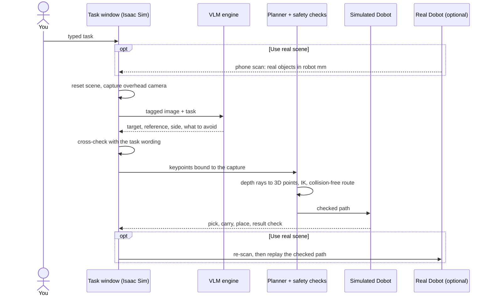
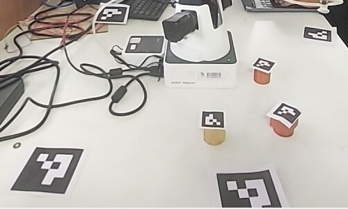
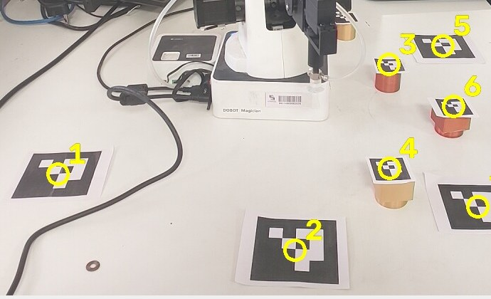
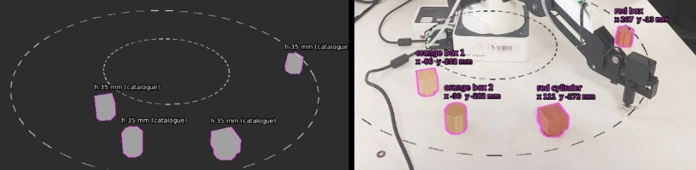

<div align="center">

# Dobot Magician VLM pick-and-place

**Type a task in plain English. A vision-language model reads it against the camera image, NVIDIA Isaac Sim plans
and checks the motion, and a Dobot Magician carries it out, first in simulation, then on the real arm.**


</div>


https://github.com/user-attachments/assets/50da6a2c-5191-49c3-a10d-c303a0387f9a


<p align="center"><em>Simulation. Task: "pick up the green cube and place it next to the cylinder".
The waiting (scene capture, VLM engine, path planning and safety checks) is fast-forwarded; the robot's motion
is real time. No training data and no hand-taught paths.</em></p>

## What it does

```text
"pick the red cylinder, place it beside the purple cone and avoid the green sphere"
```

1. The overhead camera image is captured and every object in it is found.
2. A **vision-language model** sees the image with a numbered tag on each object. It answers only *which tag to
   pick, which tag is the reference, which side, and what to avoid*. It never guesses coordinates.
3. The chosen pixels become real 3D points through **depth rays** into the scene. **Inverse kinematics** and an
   **obstacle-aware route planner** work out a safe path for the held object.
4. The simulated Dobot picks, carries, places and returns home. A **result check** confirms the task was done.
5. **Real robot (optional):** an ordinary **phone camera** finds the real objects. They are mirrored into the
   simulation and the task is planned and checked there. Only a checked path is replayed on the real Dobot.

## Architecture



Details: [docs/ARCHITECTURE.md](docs/ARCHITECTURE.md).

## Real-world setup

The real arm uses a phone as its only camera (no depth camera). The phone is calibrated against the arm by touching
printed ArUco markers, on the table and on top of boxes, with the suction tip. Objects are then found by comparing
each photo with a photo of the empty table.

<table>
<tr>
<td width="50%"></td>
<td width="50%"></td>
</tr>
<tr>
<td align="center"><em>Lab setup: Dobot Magician, calibration markers, test objects</em></td>
<td align="center"><em><code>calibrate-all</code>: every marker found and numbered from one photo</em></td>
</tr>
<tr>
<td colspan="2"></td>
</tr>
<tr>
<td colspan="2" align="center"><em>Phone camera view: estimated height map (left) and detected objects with their
position in robot millimetres (right). This view replaces the depth camera.</em></td>
</tr>
</table>

<!-- Real-robot video: drag the video file into the README editor on GitHub, then put the link it creates on its own line here. -->

## Status

| Part | State |
|---|---|
| Simulation pipeline (capture → VLM → plan → pick and place → result check → reset) | ✅ Works in Isaac Sim 6.0.1 |
| VLM providers: OpenAI-compatible APIs, Claude API, Claude Code CLI, local models, no-model fallback | ✅ Implemented |
| Phone-camera calibration, object detection, RGB "height map" view | ✅ Works with an Android phone (IP Webcam) |
| Real Dobot driver, bridge, teleop, auto-park | ✅ Teleop and homing tested on the arm |
| Real-robot replay of a simulated plan | 🧪 In testing |

## Requirements

- Ubuntu 22.04 or 24.04 with an NVIDIA RTX GPU (8 GB VRAM is enough), NVIDIA Isaac Sim 6.0.x
- The scene assets (USD stage, URDF, Lula YAML). See [assets/README.md](assets/README.md).
- A vision-language model: any OpenAI-compatible API with image input, a local model, the Claude API, or a
  signed-in Claude Code CLI
- Real robot only: Dobot Magician with suction cup, USB cable, and an Android phone with the IP Webcam app

## Quick start (simulation)

```bash
git clone https://github.com/<you>/dobot-vlm-pick-place.git
cd dobot-vlm-pick-place
cp .env.example .env            # then set VLM_PROVIDER, VLM_API_BASE, VLM_MODEL, VLM_API_KEY
# put the scene assets in assets/ (see assets/README.md)
bash scripts/start_dobot.sh --check   # checks files, VLM access, GPU
bash scripts/start_dobot.sh           # opens Isaac Sim with the "Dobot pick-and-place" window
```

Type a task in the window and press **Run task**. Full setup: [docs/SETUP.md](docs/SETUP.md).

## Choosing the VLM

Set `VLM_PROVIDER` in `.env`:

| Provider | Settings | Notes |
|---|---|---|
| `openai` | `VLM_API_BASE`, `VLM_MODEL`, `VLM_API_KEY` | OpenAI, OpenRouter, Gemini's OpenAI endpoint, Groq, Ollama, vLLM, LM Studio, local routers |
| `anthropic` | `ANTHROPIC_API_KEY`, `VLM_MODEL` | Claude API, billed per request |
| `claude_code` | `VLM_CLAUDE_CODE_MODEL` | Claude Code CLI on a Claude subscription; API keys in the environment are removed for the call |
| `none` | | No model: unambiguous tasks are decided from their wording |

Several providers at once (`VLM_PROVIDER=openai,claude_code`) are asked in parallel, and their answers must agree.
Test the connection with `python3 src/dobot_vlm_keypoints.py --check`. Details: [docs/VLM.md](docs/VLM.md).

### Running with a local model (no API key, no internet)

The model only has to say which numbered tag is which. It never estimates coordinates, so a small local vision
model on the same laptop is enough. With [Ollama](https://ollama.com):

```bash
ollama pull qwen2.5vl:7b          # any vision model; smaller ones answer faster
```

```ini
# .env
VLM_PROVIDER=openai
VLM_API_BASE=http://127.0.0.1:11434/v1
VLM_MODEL=qwen2.5vl:7b
VLM_API_KEY=
```

Then run `python3 src/dobot_vlm_keypoints.py --check`. It should print `route openai up ok (model offered)`.

- A 7B vision model in 4-bit needs about 6 GB of GPU memory. Isaac Sim needs most of an 8 GB card, so on a laptop
  you may have to run the model on the CPU (slower), or use a smaller model.
- Raise `VLM_DEADLINE_S` (default 40 s) if the first answer is slow while the model loads.
- The answer is still cross-checked against the task wording, and every pixel is verified with depth rays before
  the arm moves. With a weaker model, name objects clearly in the task ("the red cylinder"): the wording check
  can then catch a wrong answer.

## Real robot

```bash
bash scripts/setup_real.sh      # once: Python environment, serial access, phone camera, Dobot check
# once: calibrate the phone camera against the arm (docs/REAL_ROBOT.md)
bash scripts/start_real.sh      # every session: phone link, Dobot bridge, Isaac Sim
```

Tick **Use real scene**, press **Run task**, check the plan in the Phone camera window, then click
**Send to real Dobot** twice. Step-by-step guide: [docs/REAL_ROBOT.md](docs/REAL_ROBOT.md).

## Repository layout

```text
src/            runtime scripts (Isaac Sim side and real-robot side), all in one folder because they load each other
scripts/        start_dobot.sh, start_real.sh, setup_real.sh (+ _env.sh, shared settings loader)
diagnostics/    read-only Isaac Sim scene and gripper audits
tools/          git hooks, Windows replay of a plan
docs/           setup, VLM, real robot, architecture, troubleshooting
assets/         scene assets (not in git)
output/         run data: captures, VLM decisions, calibration, run log (created at run time, not in git)
```

| File | Role |
|---|---|
| `src/dobot_run_task.py` | Task window in Isaac Sim: Run task, Reset scene, Stop, test lists, real-robot controls |
| `src/dobot_capture_overhead.py` | Renders the overhead camera, checks the camera model, writes `capture.json` |
| `src/dobot_vlm_keypoints.py` | VLM engine: tagged image → target / reference / relation → `keypoints_2d_vlm.json` |
| `src/dobot_pnp_run_simulation_v3.py` | Checks the keypoints against the capture, then runs the controller |
| `src/dobot_pnp_run_simulation_isaacsim6_v2.py` | Controller: depth rays, IK, route planning, kinematic suction latch |
| `src/dobot_real.py` | Real side: phone camera, calibration, scan, plan, execute |
| `src/dobot_link.py` | Dobot serial driver and localhost bridge (`serve`) |
| `src/dobot_teleop.py` | Keyboard teleop of the real arm and suction (standalone) |
| `src/dobot_run_report.py` | Terminal summary of recorded runs |

## Safety

- Every plan runs in simulation first. The real arm only replays a path that passed the result check, after a
  re-scan shows nothing moved.
- Moves are limited to a reach ring (135–315 mm from the base), never below the table, at reduced speed.
- The Dobot Magician has no emergency stop. Keep a hand near the power switch, and use **Stop** in the task
  window or Ctrl+C in a terminal.
- The robot bridge only listens on `127.0.0.1`.

## Troubleshooting

See [docs/TROUBLESHOOTING.md](docs/TROUBLESHOOTING.md).

## Videos


| Video | What it shows |
|---|---|
|https://github.com/user-attachments/assets/50da6a2c-5191-49c3-a10d-c303a0387f9a | Isaac Sim: typed task → VLM engine → path planning + safety checks → pick, carry, place |
<!-- | [Real robot](PASTE-LINK) | Phone-camera scan → simulated check → real Dobot replay | -->
