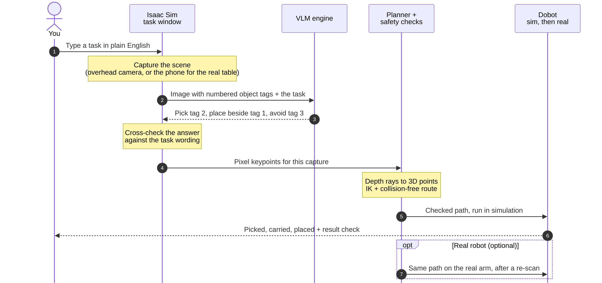
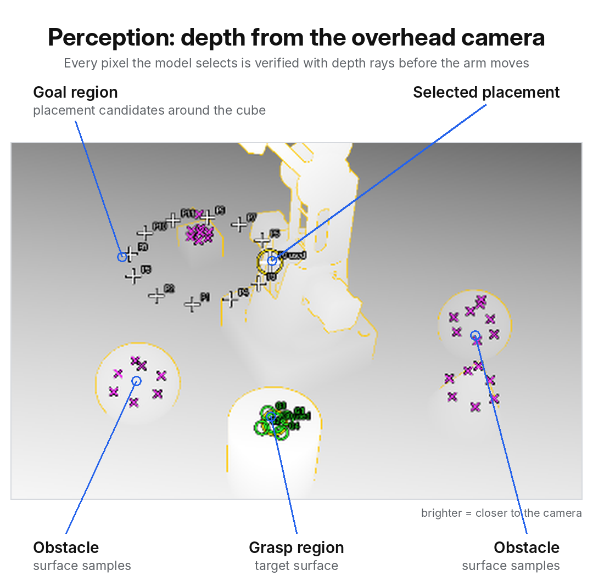
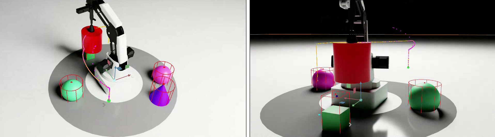

<div align="center">

# Dobot Magician VLM pick-and-place

**A robot arm that carries out pick-and-place tasks from plain-English instructions.** A vision-language model
reads the instruction against the camera image, geometry verifies its answer, and a planner moves a Dobot Magician
along a collision-free path in NVIDIA Isaac Sim.


</div>

<div align="center">

https://github.com/user-attachments/assets/90788885-9483-4c5e-946d-1967df6facf4

<em>"pick up the red cylinder and place it next to the cube": typed instruction, depth view, then execution.<br>
Top: overhead simulation camera. Bottom: free viewpoint. 2.5× speed.</em>

</div>

## How it works

1. **Capture.** The overhead camera image is captured and each object gets a numbered tag.
2. **Ground the instruction.** A vision-language model reads the instruction against the tagged image and answers
   which object to pick, where to place it and what to avoid. It is not asked for coordinates.
3. **Verify with geometry.** The selected pixels are cast into the scene as depth rays to get 3D grasp and
   placement points, support heights and obstacle footprints.
4. **Plan.** Inverse kinematics and a polar-grid route planner compute a path that keeps the held object clear of
   every obstacle.
5. **Execute and check.** The arm picks, carries and places, and the final position is checked against the
   instruction.



More detail: [docs/ARCHITECTURE.md](docs/ARCHITECTURE.md).

## Results

<table>
<tr>
<td width="50%" align="center"></td>
<td width="50%" align="center"></td>
</tr>
<tr>
<td align="center"><em><b>Simulation:</b> depth from the overhead camera with the grasp region, goal region,
selected placement and obstacle samples</em></td>
<td align="center"><em><b>Real table:</b> the same scene description from a calibrated phone camera, with each object
located in robot millimetres</em></td>
</tr>
<tr>
<td align="center"></td>
<td align="center"></td>
</tr>
<tr>
<td align="center"><em><b>Simulation:</b> transit along the planned path, clear of the obstacle footprints (red)</em></td>
<td align="center"><em><b>Real table:</b> camera-to-robot calibration with ArUco markers touched by the suction tip</em></td>
</tr>
</table>

## Design highlights

- **Language in, verified motion out.** The model decides *what* to move; geometry decides *where* and *how*. Its
  answer is checked against the scene (depth rays, reachability, clearance) before any motion is commanded.
- **Model-agnostic grounding.** The grounding step works with OpenAI-compatible APIs, the Claude API or a local
  vision model, and is cross-checked against the wording of the instruction.
- **Obstacle-aware planning.** A shortest-path search over the arm's reachable workspace keeps the held object's
  real footprint clear of every obstacle, with damped least-squares inverse kinematics.
- **Simulation as the safety gate for the real arm.** The real table is mirrored into the simulation from a phone
  camera; only a path that passes there is sent to the physical Dobot.

## Status

| Part | State |
|---|---|
| Simulation pipeline (capture → VLM → plan → pick and place → result check → reset) | ✅ Works in Isaac Sim 6.0.1 |
| VLM providers: OpenAI-compatible APIs, Claude API, Claude Code CLI, local models, no-model fallback | ✅ Implemented |
| Phone-camera calibration, object detection, RGB "height map" view | ✅ Works with an Android phone (IP Webcam) |
| Real Dobot driver, bridge, teleop, auto-park | ✅ Teleop and homing tested on the arm |
| Real-robot replay of a simulated plan | 🧪 In testing |

## Getting started

Requires Ubuntu with an NVIDIA RTX GPU, NVIDIA Isaac Sim 6.0 and a vision-language model (API or local).

```bash
git clone https://github.com/Fe3w/dobot-vlm-vla-pick-place.git
cd dobot-vlm-vla-pick-place
cp .env.example .env                 # choose the VLM provider
bash scripts/start_dobot.sh          # opens Isaac Sim with the task window
```

Full instructions (requirements, model setup including local models, real robot, repository layout, safety):
**[docs/GUIDE.md](docs/GUIDE.md)**. Also: [setup](docs/SETUP.md) · [VLM providers](docs/VLM.md) ·
[real robot](docs/REAL_ROBOT.md) · [troubleshooting](docs/TROUBLESHOOTING.md).

## Videos

| Video | What it shows |
|---|---|
| [Pick and place, two views](https://github.com/user-attachments/assets/90788885-9483-4c5e-946d-1967df6facf4) | Typed instruction → depth view → execution, overhead camera and free viewpoint (2.5×) |
| [First simulation run](https://github.com/user-attachments/assets/3d14c2cb-25bf-4d8f-99ec-96a852c00af8) | "pick up the green cube and place it next to the cylinder" |
