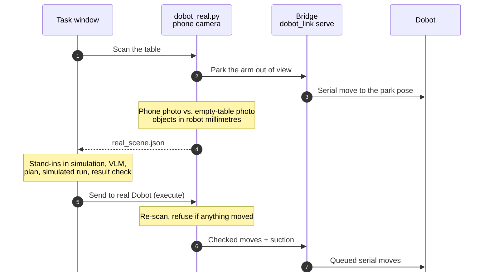

# Architecture

## Modules

| Stage | File | In → out |
|---|---|---|
| Task window | `src/dobot_run_task.py` | typed task → runs every stage below; Reset / Stop / test lists / real-robot buttons |
| Capture | `src/dobot_capture_overhead.py` | `/overhead_camera` render → `capture.json` (image hash, intrinsics, object list with outlines and poses) |
| Grounding | `src/dobot_vlm_keypoints.py` | capture + task → tagged image → VLM routes → `keypoints_2d_vlm.json` bound to the capture id and image hash |
| Guarded run | `src/dobot_pnp_run_simulation_v3.py` | refuses unbound or stale keypoints; loads the reviewed controller (SHA-256 checked); result check |
| Controller | `src/dobot_pnp_run_simulation_isaacsim6_v2.py` | keypoints → depth rays → IK → route → motion → `runs.jsonl` |
| Wrist | `src/dobot_wrist_level.py` | measured `joint_6` rule, keeps the cup pointing down |
| Real side | `src/dobot_real.py`, `src/dobot_link.py`, `src/dobot_rgb_view.py` | phone + calibration → `real_scene.json`; checked plan → Dobot moves |

## Controller pipeline

1. **Depth.** Each keypoint pixel is back-projected through the camera model and cast against PhysX colliders and
   visible USD geometry. The robot's own links are excluded.
2. **Target.** The grasp ray must land on the intended pickable rigid body. If the stored pixels miss, the
   object's projected top centre is tried. A ring of samples around the pixel gives the support surface and the
   object height.
3. **Obstacles.** Obstacle pixels become convex footprints with top heights, taken from the real geometry at its
   live pose.
4. **Placement.** Candidates are tried in order: a flat surface, a reachable release pose, then a route.
5. **Route.** A shortest path on a polar (radius, azimuth) grid. The tip rides just under the arm's reach
   ceiling, and the held object's rotated footprint keeps a margin from every obstacle or passes above it. The
   path is shortcut-smoothed and IK-checked point by point.
6. **IK.** Lula gives forward kinematics and a seed; a damped least-squares solve runs on `joint_1/2/5` with
   `joint_6 = s·(joint_2 + joint_5) + b`. Targets are for the measured suction tip, not the link origin.
7. **Motion.** HOME → above pick → hover → closed-loop touchdown → latch → lift → transit → descent → release →
   back-off → HOME. A contact watchdog stops the arm if the held object touches anything in transit.
8. **Suction.** A kinematic latch: the object becomes kinematic and follows `link_suction` every physics step.
   It is filtered against the suction link only, so it stays solid to everything else. On release its physics
   state is restored.

## Real-scene flow

Frames: the camera is calibrated to the Dobot's own Cartesian frame (mm). The simulation's base frame matches it
in x/y after `YAW_DEG`, and heights are matched through the table surface.

## Data written per run

`$DOBOT_DATA/output/isaac_capture/<capture>/`: `rgb.png`, `capture.json`, `keypoints_2d_vlm.json`,
`vlm_runs/<run>/` (tagged image, redacted request, each route's answer, decision), depth views. `runs.jsonl`
records every run (result, timing, memory, tracking error). `src/dobot_run_report.py` summarises it.
